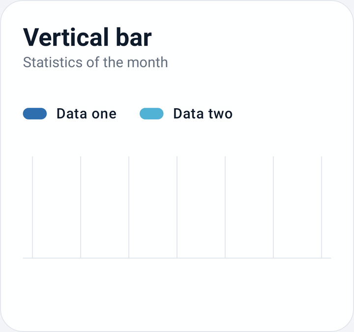
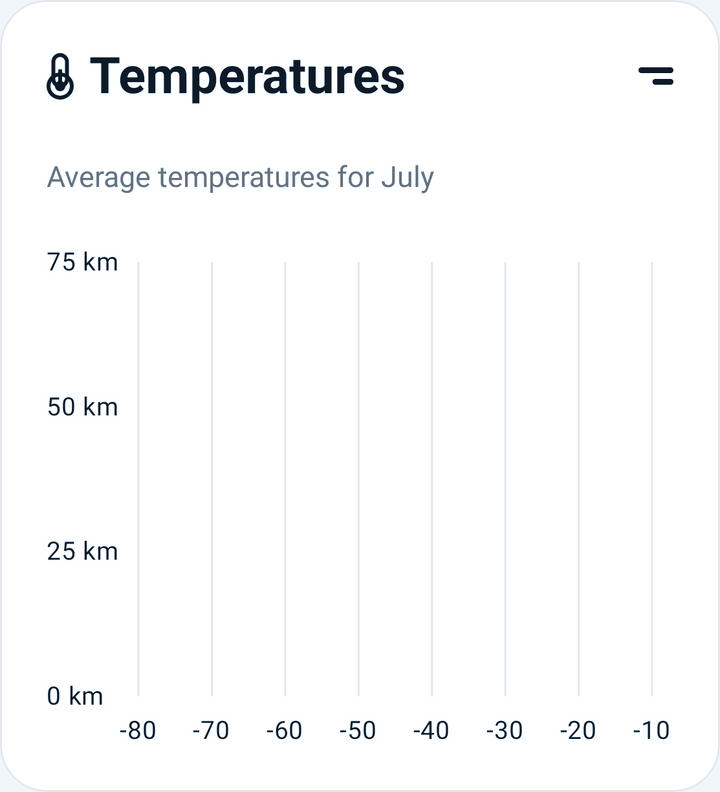
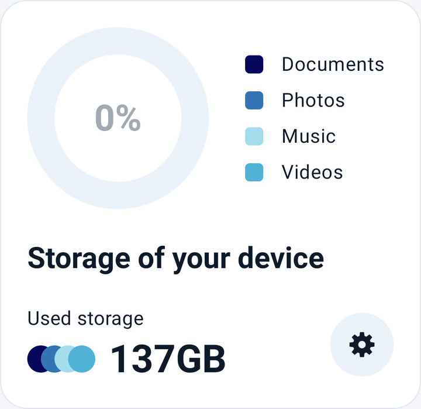
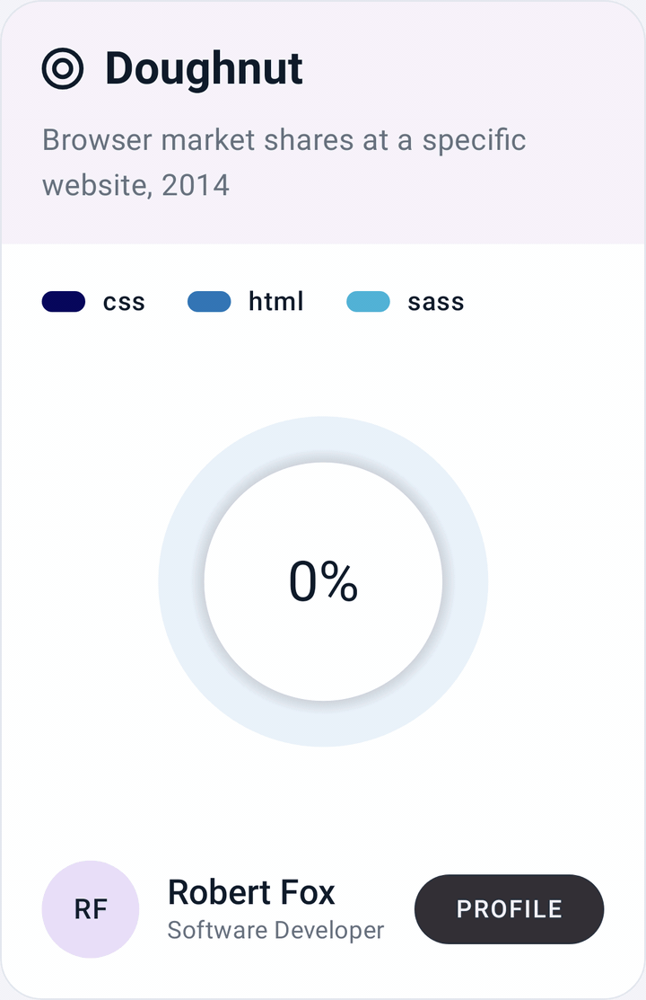
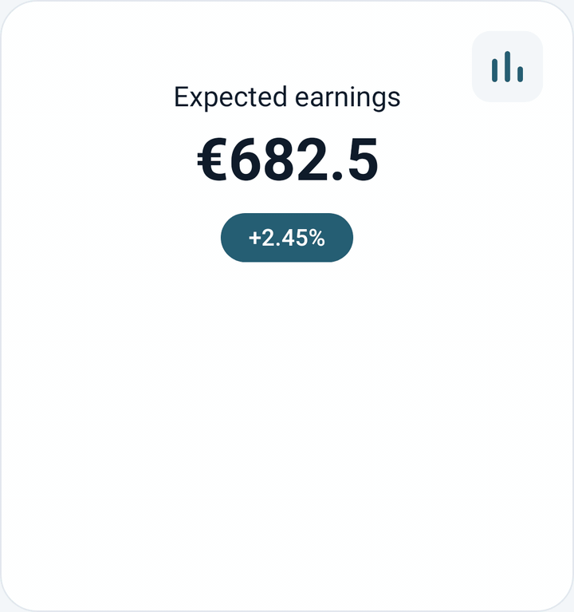
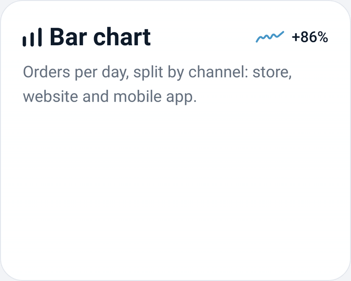

<div align="center">


# Compose Charts

**Beautiful, animated, fully customizable charts for Jetpack Compose.**

Drop-in chart cards that look great by default, and a styling API that lets you change every colour, size and spacing.


[](https://central.sonatype.com/artifact/io.github.nameisjayant/compose-charts)


</div>

---

## Preview

<table>
  <tr>
    <th>Vertical bar</th>
    <th>Area range and line</th>
  </tr>
  <tr>
    <td valign="top"></td>
    <td valign="top"></td>
  </tr>
  <tr>
    <td>Two series compared above and below a shared baseline.</td>
    <td>A smooth line inside a soft ribbon that can run in any direction.</td>
  </tr>
  <tr>
    <th>Donut</th>
    <th>Doughnut</th>
  </tr>
  <tr>
    <td valign="top"></td>
    <td valign="top"></td>
  </tr>
  <tr>
    <td>Rounded segments filling a gauge, with the percentage counting up in the centre.</td>
    <td>Segments that thicken one after another around a shaded hole.</td>
  </tr>
  <tr>
    <th>Spline area</th>
    <th>Stacked bar</th>
  </tr>
  <tr>
    <td valign="top"></td>
    <td valign="top"></td>
  </tr>
  <tr>
    <td>A thick smoothed line over a fading fill, edge to edge.</td>
    <td>Rounded stacks of several series, with a trend label in the corner.</td>
  </tr>
</table>

## Features

- 📊 **Ready-made chart cards**: title, subtitle, legend and an action slot, all built in.
- 🎨 **Every visual is configurable** through immutable `XxxStyle` classes built with `XxxDefaults.style(...)`.
- ✨ **Animated by default**: values animate on first draw and whenever the data changes. Pass `animationSpec = null` to turn it off.
- 🧩 **Use the parts you need**: use a full `XxxChartCard`, or put the bare chart composable inside your own layout.
- 🪶 **Light dependencies**: only Compose UI, Foundation and Coroutines. No Hilt, Material or navigation library is forced on your app.
- 🔒 **Explicit API mode**, so the public API is exactly what is meant to be public.

## Charts

| Chart | Composables | Highlights |
|---|---|---|
| **Vertical bar** | `VerticalBarChart`, `VerticalBarChartCard` | One or two series (up and down from a baseline), pill-shaped bars, grid lines |
| **Area range and line** | `AreaRangeLineChart`, `AreaRangeLineChartCard` | Smoothed line, fading ribbon, data points, axis ranges and label formatters |
| **Donut** | `DonutChart`, `DonutChartCard` | Rounded overlapping segments on a track, animated percentage in the centre, side legend and a summary row |
| **Doughnut** | `DoughnutChart`, `DoughnutChartCard` | Segments that get thicker one after another, a shaded hole, a tinted header and a footer slot |
| **Spline area** | `SplineAreaChart`, `SplineAreaChartCard` | A thick smoothed line over a fading fill, edge to edge, under a headline value, change badge and action tile |
| **Stacked bar** | `StackedBarChart`, `StackedBarChartCard` | Any number of series stacked per bar, rounded stack ends, a title icon, a description and a trend label |

More charts are on the way.

## Installation

Compose Charts is published on [Maven Central](https://central.sonatype.com/artifact/io.github.nameisjayant/compose-charts). No extra repository is needed, just make sure `mavenCentral()` is listed (new Android projects include it by default):

```kotlin
// settings.gradle.kts
dependencyResolutionManagement {
    repositories {
        google()
        mavenCentral()
    }
}
```

Then add the dependency:

```kotlin
// app/build.gradle.kts
dependencies {
    implementation("io.github.nameisjayant:compose-charts:0.1.0")
}
```

<details>
<summary>Version catalog</summary>

```toml
[versions]
composeCharts = "0.1.0"

[libraries]
compose-charts = { group = "io.github.nameisjayant", name = "compose-charts", version.ref = "composeCharts" }
```

</details>

## Usage

Every chart comes in two versions:

- **`XxxChartCard`**: the chart inside a ready-made card, with a title, subtitle, legend and action slot.
- **`XxxChart`**: the bare chart, with no card frame, to put inside your own layout. Give it a size with `modifier`.

### Vertical bar

```kotlin
val upperSeries = BarSeries(
    label = "Data one",
    values = listOf(90f, 24f, 63f, 39f, 46f, 49f, 61f),
    color = VerticalBarChartDefaults.UpperBarColor,
)
val lowerSeries = BarSeries(
    label = "Data two",
    values = listOf(14f, 32f, 20f, 28f, 45f, 32f, 28f),
    color = VerticalBarChartDefaults.LowerBarColor,
)
```

**Chart card**

```kotlin
VerticalBarChartCard(
    title = "Vertical bar",
    subtitle = "Statistics of the month",
    upperSeries = upperSeries,
    lowerSeries = lowerSeries,
    chartStyle = VerticalBarChartDefaults.style(barWidth = 24.dp),
)
```

**Chart only**

```kotlin
VerticalBarChart(
    upperSeries = upperSeries,
    lowerSeries = lowerSeries,
    modifier = Modifier.fillMaxWidth().height(160.dp),
    style = VerticalBarChartDefaults.style(barWidth = 24.dp),
)
```

### Area range and line

```kotlin
val series = AreaRangeLineSeries(
    label = "Temperature",
    points = listOf(
        LinePoint(x = -77f, y = 75f),
        LinePoint(x = -39f, y = 53f),
        LinePoint(x = -66f, y = 24f),
        LinePoint(x = -40f, y = 14f),
        LinePoint(x = -17f, y = 5f),
    ),
    lineColor = AreaRangeLineChartDefaults.LineColor,
    bandColor = AreaRangeLineChartDefaults.BandColor,
    pointColor = AreaRangeLineChartDefaults.PointColor,
)
```

**Chart card**

```kotlin
AreaRangeLineChartCard(
    title = "Temperatures",
    subtitle = "Average temperatures for July",
    series = series,
    xRange = AxisRange(min = -80f, max = -10f, step = 10f),
    yRange = AxisRange(min = 0f, max = 75f, step = 25f),
    yLabelFormatter = { "${it.roundToInt()} km" },
)
```

**Chart only**

```kotlin
AreaRangeLineChart(
    series = series,
    modifier = Modifier.fillMaxWidth().height(220.dp),
    xRange = AxisRange(min = -80f, max = -10f, step = 10f),
    yRange = AxisRange(min = 0f, max = 75f, step = 25f),
    yLabelFormatter = { "${it.roundToInt()} km" },
)
```

Points are joined in list order, so the line can run top to bottom, as in the altitude profile above. If you leave out `xRange` or `yRange`, a range with round step values is picked for you.

### Donut

```kotlin
val segments = listOf(
    DonutSegment("Documents", 22f, DonutChartDefaults.DocumentsColor),
    DonutSegment("Photos", 47f, DonutChartDefaults.PhotosColor),
    DonutSegment("Music", 38f, DonutChartDefaults.MusicColor),
    DonutSegment("Videos", 30f, DonutChartDefaults.VideosColor),
)
```

**Chart card**

```kotlin
DonutChartCard(
    title = "Storage of your device",
    segments = segments,
    maxValue = 178f,
    caption = "Used storage",
    value = "137GB",
    action = { ChartSettingsIcon() },
)
```

**Chart only**

```kotlin
DonutChart(
    segments = segments,
    modifier = Modifier.size(160.dp),
    maxValue = 178f,
)
```

With `maxValue` the ring works as a gauge: the segments fill 137 of 178, and the centre shows `77%`. Leave it out and the segments share the whole ring. Use `centerLabelFormatter` to change the centre text, and `DonutChartDefaults.style(startAngle = -90f)` to start at 12 o'clock.

### Doughnut

```kotlin
val segments = listOf(
    DonutSegment("css", 11f, DoughnutChartDefaults.CssColor),
    DonutSegment("html", 12f, DoughnutChartDefaults.HtmlColor),
    DonutSegment("sass", 50f, DoughnutChartDefaults.SassColor),
)
```

**Chart card**

```kotlin
DoughnutChartCard(
    title = "Doughnut",
    subtitle = "Browser market shares at a specific website, 2014",
    segments = segments,
    maxValue = 100f,
    footer = { /* e.g. an avatar, a name and a profile button */ },
)
```

**Chart only**

```kotlin
DoughnutChart(
    segments = segments,
    modifier = Modifier.size(200.dp),
    maxValue = 100f,
)
```

Each segment is a little thicker than the one before, and the last one reaches the edge. The segments run clockwise and finish at 12 o'clock, so the empty track sits just before it, and the centre shows the filled share (`73%`). Use `DoughnutChartDefaults.style(endAngle = ..., firstSegmentRadiusFraction = ..., holeRadiusFraction = ...)` to move the end point, change how much the segments thicken, or resize the hole.

### Spline area

```kotlin
val trend = listOf(180f, 148f, 194f, 184f, 255f, 120f, 200f, 248f, 194f, 200f, 140f, 196f, 192f, 248f)
```

**Chart card**

```kotlin
SplineAreaChartCard(
    title = "Expected earnings",
    value = "€682.5",
    badge = "+2.45%",
    values = trend,
    action = { ChartBarsIcon(color = SplineAreaChartCardDefaults.ActionIconColor) },
)
```

**Chart only**

```kotlin
SplineAreaChart(
    values = trend,
    modifier = Modifier.fillMaxWidth().height(170.dp),
)
```

The values are spread evenly from the left edge to the right edge, and in the card the chart reaches the card's left, right and bottom edges. By default the line is scaled to the data's own range, with the lowest value 45% of the way up so the fill has room to fade. Pass `minValue = 0f` and `SplineAreaChartDefaults.style(bottomSpaceFraction = 0f)` to measure from zero instead.

### Stacked bar

```kotlin
val series = listOf(
    BarSeries("Store", listOf(70f, 40f, 22f, 40f, 17f, 21f, 13f, 8f), StackedBarChartDefaults.BottomColor),
    BarSeries("Web", listOf(30f, 62f, 55f, 28f, 15f, 19f, 10f, 6f), StackedBarChartDefaults.MiddleColor),
    BarSeries("App", listOf(30f, 18f, 29f, 15f, 30f, 10f, 17f, 40f), StackedBarChartDefaults.TopColor),
)
```

**Chart card**

```kotlin
StackedBarChartCard(
    title = "Bar chart",
    subtitle = "Orders per day, split by channel: store, website and mobile app.",
    trend = "+86%",
    series = series,
)
```

**Chart only**

```kotlin
StackedBarChart(
    series = series,
    modifier = Modifier.fillMaxWidth().height(130.dp),
)
```

The first series sits at the bottom of every stack. Only the top and bottom of each whole stack are rounded; the segments inside meet flush. The bars share the width left after `barSpacing`, so they get wider when there are fewer of them. Cap them with `StackedBarChartDefaults.style(maxBarWidth = 24.dp)`. The tallest stack fills the height unless you pass `maxValue`. The legend is off by default; turn it on with `showLegend = true`, or pass your own `action` in place of the trend label.

### Styling

Every chart card has three style layers: the card, the legend and the chart itself.

```kotlin
VerticalBarChartCard(
    title = "Revenue",
    upperSeries = series,
    cardStyle = ChartCardDefaults.style(
        backgroundColor = MaterialTheme.colorScheme.surface,
        border = BorderStroke(1.dp, MaterialTheme.colorScheme.outlineVariant),
    ),
    legendStyle = ChartLegendDefaults.style(),
    chartStyle = VerticalBarChartDefaults.style(
        barWidth = 16.dp,
        showGridLines = false,
    ),
    animationSpec = tween(durationMillis = 1_000),
)
```

The bare chart takes only the chart layer, through its `style` parameter (`VerticalBarChart(style = VerticalBarChartDefaults.style(...))`).

## Sample app

The `:app` module is a showcase app with one screen per chart. Each screen has *Shuffle data* and *Reset* buttons so you can watch the charts animate. It uses Hilt and MVI ViewModels, and it follows the system light or dark theme.

```bash
./gradlew :app:installDebug
```

## Project structure

```
ComposeCharts/
├── charts/   # The library: chart composables, styles, shared ChartCard and ChartLegend
└── app/      # Showcase app (Hilt + MVI) that demos every chart
```

## Contributing

Issues and pull requests are welcome. When you add a chart:

1. Add the chart composable, its `XxxStyle` and `XxxDefaults`, plus a `XxxChartCard` wrapper in `:charts`.
2. Add a `ChartSample` entry in `ChartSampleRepository` and a screen in `:app`.
3. Add a test to `RecordChartGifs` in `:app`, run `./scripts/record-chart-gifs.sh` to render the GIFs into `docs/gifs/` (needs `ffmpeg`), and add the chart to the tables above.

## Publishing a release

The `:charts` module is published with the [vanniktech maven-publish plugin](https://github.com/vanniktech/gradle-maven-publish-plugin). The Central Portal token and the GPG signing key live in `~/.gradle/gradle.properties`, never in this repo:

```properties
mavenCentralUsername=<portal token username>
mavenCentralPassword=<portal token password>
signingInMemoryKeyId=<last 8 chars of the key id>
signingInMemoryKeyPassword=<key passphrase>
signingInMemoryKey=<ascii-armored private key, on one line>
```

To release:

1. Bump `VERSION_NAME` in `gradle.properties`.
2. Optionally test the build locally with `./gradlew :charts:publishToMavenLocal`.
3. Run `./gradlew :charts:publishToMavenCentral`. The release is published automatically and shows up on Maven Central within about 30 minutes.

<div align="center">

Licensed under the [Apache License 2.0](LICENSE).

Made with ❤️ and Jetpack Compose by [Jayant Kumar](https://github.com/nameisjayant)

</div>
