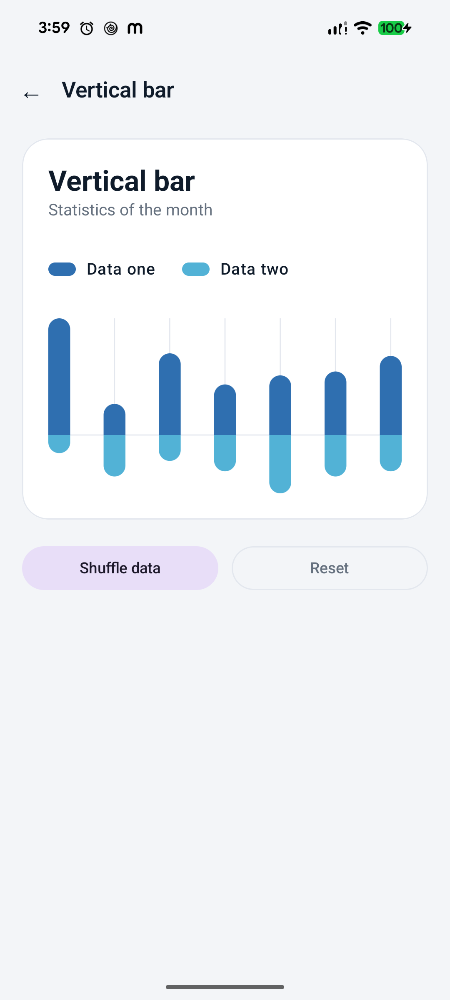
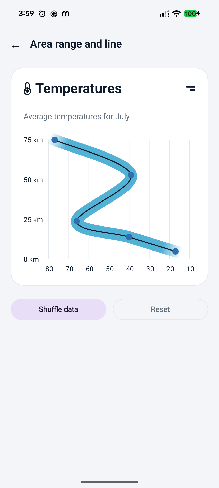

<div align="center">


# Compose Charts

**Beautiful, animated, fully customizable charts for Jetpack Compose.**

Drop-in chart cards that look great by default, and a styling API that lets you change every colour, size and spacing.


</div>

---

## Screenshots

<table>
  <tr>
    <th>Vertical bar</th>
    <th>Area range and line</th>
  </tr>
  <tr>
    <td></td>
    <td></td>
  </tr>
  <tr>
    <td>Two series compared above and below a shared baseline.</td>
    <td>A smooth line inside a soft ribbon that can run in any direction.</td>
  </tr>
</table>

## Features

- 📊 **Ready-made chart cards**: title, subtitle, legend and an action slot, all built in.
- 🎨 **Every visual is configurable** through immutable `XxxStyle` classes built with `XxxDefaults.style(...)`.
- ✨ **Animated by default**: values animate on first draw and whenever the data changes. Pass `animationSpec = null` to turn it off.
- 🧩 **Use the parts you need**: use a full `XxxChartCard`, or put the bare chart composable inside your own layout.
- 🪶 **Light dependencies**: only Compose UI, Foundation and Coroutines. No Hilt, Material or navigation library is forced on your app.
- 🔒 **Explicit API mode**, so the public API is exactly what is meant to be public.

## Charts

| Chart | Composables | Highlights |
|---|---|---|
| **Vertical bar** | `VerticalBarChart`, `VerticalBarChartCard` | One or two series (up and down from a baseline), pill-shaped bars, grid lines |
| **Area range and line** | `AreaRangeLineChart`, `AreaRangeLineChartCard` | Smoothed line, fading ribbon, data points, axis ranges and label formatters |

More charts are on the way.

## Installation

The library is not on Maven Central yet. For now, publish it to your local Maven repository:

```bash
./gradlew :charts:publishToMavenLocal
```

Then add it to your project:

```kotlin
// settings.gradle.kts
dependencyResolutionManagement {
    repositories {
        mavenLocal()
        google()
        mavenCentral()
    }
}

// app/build.gradle.kts
dependencies {
    implementation("com.nameisjayant:compose-charts:0.1.0")
}
```

## Usage

### Vertical bar

```kotlin
VerticalBarChartCard(
    title = "Vertical bar",
    subtitle = "Statistics of the month",
    upperSeries = BarSeries(
        label = "Data one",
        values = listOf(90f, 24f, 63f, 39f, 46f, 49f, 61f),
        color = VerticalBarChartDefaults.UpperBarColor,
    ),
    lowerSeries = BarSeries(
        label = "Data two",
        values = listOf(14f, 32f, 20f, 28f, 45f, 32f, 28f),
        color = VerticalBarChartDefaults.LowerBarColor,
    ),
    chartStyle = VerticalBarChartDefaults.style(barWidth = 24.dp),
)
```

### Area range and line

```kotlin
AreaRangeLineChartCard(
    title = "Temperatures",
    subtitle = "Average temperatures for July",
    series = AreaRangeLineSeries(
        label = "Temperature",
        points = listOf(
            LinePoint(x = -77f, y = 75f),
            LinePoint(x = -39f, y = 53f),
            LinePoint(x = -66f, y = 24f),
            LinePoint(x = -40f, y = 14f),
            LinePoint(x = -17f, y = 5f),
        ),
        lineColor = AreaRangeLineChartDefaults.LineColor,
        bandColor = AreaRangeLineChartDefaults.BandColor,
        pointColor = AreaRangeLineChartDefaults.PointColor,
    ),
    xRange = AxisRange(min = -80f, max = -10f, step = 10f),
    yRange = AxisRange(min = 0f, max = 75f, step = 25f),
    yLabelFormatter = { "${it.roundToInt()} km" },
)
```

Points are joined in list order, so the line can run top to bottom, as in the altitude profile above. If you leave out `xRange` or `yRange`, a range with round step values is picked for you.

### Styling

Every chart has three style layers: the card, the legend and the chart itself.

```kotlin
VerticalBarChartCard(
    title = "Revenue",
    upperSeries = series,
    cardStyle = ChartCardDefaults.style(
        backgroundColor = MaterialTheme.colorScheme.surface,
        border = BorderStroke(1.dp, MaterialTheme.colorScheme.outlineVariant),
    ),
    legendStyle = ChartLegendDefaults.style(),
    chartStyle = VerticalBarChartDefaults.style(
        barWidth = 16.dp,
        showGridLines = false,
    ),
    animationSpec = tween(durationMillis = 1_000),
)
```

To leave out the card frame, use the bare chart:

```kotlin
VerticalBarChart(
    upperSeries = series,
    modifier = Modifier.fillMaxWidth().height(160.dp),
)
```

## Sample app

The `:app` module is a showcase app with one screen per chart. Each screen has *Shuffle data* and *Reset* buttons so you can watch the charts animate. It uses Hilt and MVI ViewModels, and it follows the system light or dark theme.

```bash
./gradlew :app:installDebug
```

## Project structure

```
ComposeCharts/
├── charts/   # The library: chart composables, styles, shared ChartCard and ChartLegend
└── app/      # Showcase app (Hilt + MVI) that demos every chart
```

## Contributing

Issues and pull requests are welcome. When you add a chart:

1. Add the chart composable, its `XxxStyle` and `XxxDefaults`, plus a `XxxChartCard` wrapper in `:charts`.
2. Add a `ChartSample` entry in `ChartSampleRepository` and a screen in `:app`.
3. Add a screenshot to `docs/screenshots/` and a row to the tables above.

<div align="center">

Made with ❤️ and Jetpack Compose by [Jayant Kumar](https://github.com/nameisjayant)

</div>
